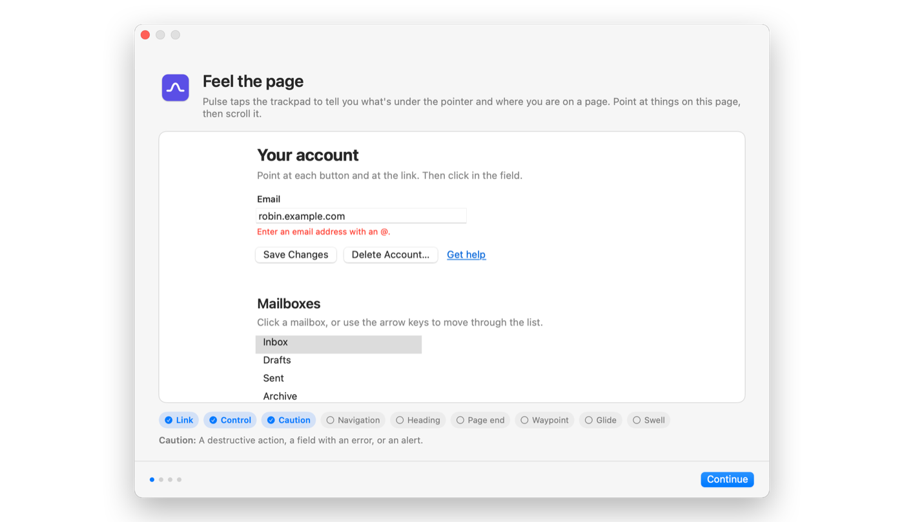
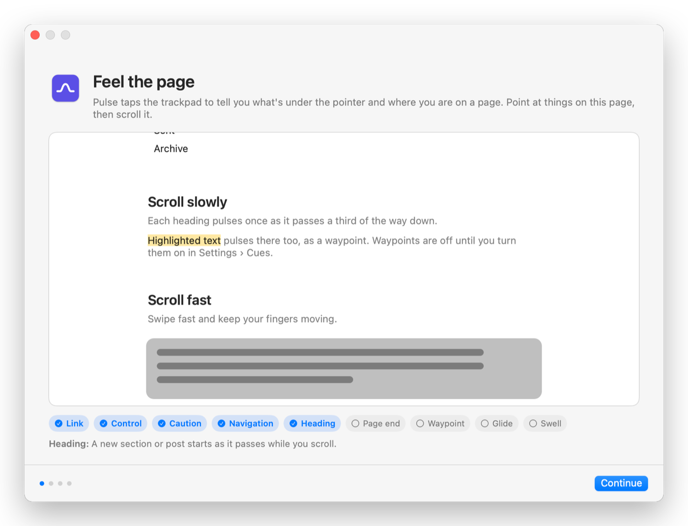

<p align="center">
  <picture>
    <source media="(prefers-color-scheme: dark)" srcset="design/logo/pulse-lockup-horizontal-reversed.svg">
    
  </picture>
</p>

<h3 align="center">Feel every scroll.</h3>

<p align="center">Pulse lets you feel web pages through your Mac's trackpad: a gentle tap at each link, button and new section. It can make typing sound nicer, too.</p>

<p align="center">
  macOS 14 or later · Apple silicon and Intel · Free<br>
  <a href="#install">Install</a> · <a href="docs/details.md">Guide</a> · <a href="#line-apps">Line Apps</a>
</p>

<p align="center">
  <picture>
    <source media="(prefers-color-scheme: dark)" srcset="docs/images/cues-dark.png">
    
  </picture>
</p>

## What it does

- **Links and buttons.** A light tap for a link, a firmer one for a button, and two strong taps for
  risky ones like "Delete".
- **Where you are.** A soft pulse when a new section starts as you scroll, and a bump at the end of
  the page.
- **Fast scrolling.** Slow scrolling is silent. Scroll fast and you feel faint pulses that keep pace
  with you.
- **Typing sounds.** Pick a sound and the keyboard it sounds like, and try them on an on-screen
  keyboard before you choose.
- **Quiet when it should be.** In password fields, on calls, while music plays, and in any app you
  turn it off for. Press **⌃⌥⌘M** to mute it.

<p align="center">
  <picture>
    <source media="(prefers-color-scheme: dark)" srcset="docs/images/tour-dark.png">
    
  </picture>
</p>

It works in Safari, Chrome, Firefox and other browsers, and in most apps, with no browser extension.
After setup it lives in the menu bar, where you can mute it, turn it off for the app you're in, or
open Settings.

## Install

```sh
brew install --cask millerroberts180/line-apps/pulse
```

Use the full name: Homebrew's own catalogue has a different app called `pulse`. Or download Pulse
from [its page](https://lineapps.vercel.app/pulse/) and drag it to Applications. On Apple silicon,
the [Line Apps installer](https://lineapps.vercel.app) puts in all four apps at once.

Pulse isn't notarized yet, so macOS stops it the first time it opens. Choose **Done**, then open
System Settings › Privacy & Security and choose **Open Anyway** beside Pulse. On macOS 14,
Control-click Pulse in Applications and choose **Open**. Setup then asks for Accessibility access,
which is how Pulse tells a link from a button.

## Private and native

- **Nothing leaves your Mac.** No analytics, no account, and no network connections. Your settings
  are the only thing Pulse saves.
- **It doesn't keep the page or your typing.** Pulse works from the roles and positions that
  Accessibility exposes ("a button", "a heading at this height"), checks a button's label in memory
  only to spot risky ones, and for typing uses only the kind of key, never the character. See
  [Privacy](docs/details.md#privacy).
- **Native.** Swift, SwiftUI and AppKit, with no package dependencies: one universal app for Apple
  silicon and Intel, about 1 MB to download.

## Requirements

- macOS 14 or later, on Apple silicon or Intel.
- A Force Touch trackpad for the taps: any recent MacBook, or a Magic Trackpad 2 or newer. Without
  one, Pulse can play soft sounds instead.
- The Accessibility permission, to tell links, buttons and headings apart.

## Build from source

```sh
scripts/signing-identity.sh   # once per Mac, so the Accessibility grant survives rebuilds
scripts/bundle.sh             # builds build/Pulse.app, universal
open build/Pulse.app
scripts/test.sh               # runs the tests
```

You need Swift 6.2; the Command Line Tools are enough. The self-test, off-screen snapshots and
releasing are in [docs/development.md](docs/development.md).

## Documentation

- **[Guide](docs/details.md):** every tap, sound and setting, and when Pulse stays quiet
- **[Development](docs/development.md):** building, checks, the self-test and snapshots
- **[Architecture](docs/architecture.md):** how Pulse finds what's under the pointer, and the
  open-source work it builds on
- **[Browser coverage](docs/browser-coverage.md):** what each browser engine exposes to
  Accessibility, measured
- **[Releasing](docs/release.md):** signing, notarizing and the links About shows
- **[Logo](design/logo/README.md):** the mark, its colours and its files
- **[Legal](docs/legal):** the EULA and privacy policy, drafts for legal review
- **[Third-party notices](THIRD_PARTY_NOTICES.md):** the open-source work Pulse adapts, and the
  sound packs its keyboards are measured from

## Line Apps

Pulse is one of four small Mac apps with one maker and one quiet design, each doing one job:

| App | What it does |
| --- | --- |
| **[Tuck](https://github.com/millerroberts180/tuck)** | Windows, files, links and notes, kept in your Mac's notch |
| **[Pulse](https://github.com/millerroberts180/pulse)** | Feel web pages through your trackpad, and give typing a nicer sound |
| **[Hum](https://github.com/millerroberts180/hum)** | The song you're playing, as album art in a small floating player |
| **[Glow](https://github.com/millerroberts180/glow)** | Brightness, volume and each monitor's own settings, for every display |

[Line Apps](https://github.com/millerroberts180/line-apps) itself is a short line in the menu bar that
their icons collapse into, and one installer for all four. The
[Homebrew tap](https://github.com/millerroberts180/homebrew-line-apps) has each app's cask.

## Licence

Pulse is free to use, with every feature for everyone. © 2026 Miller Roberts. All rights reserved.
