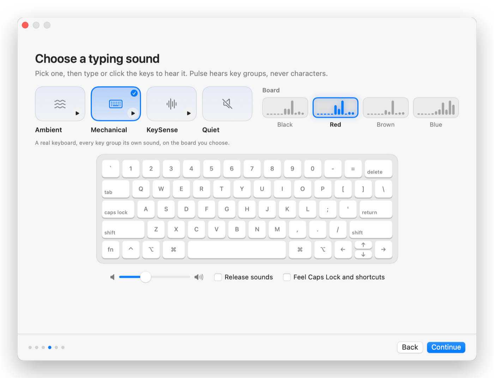
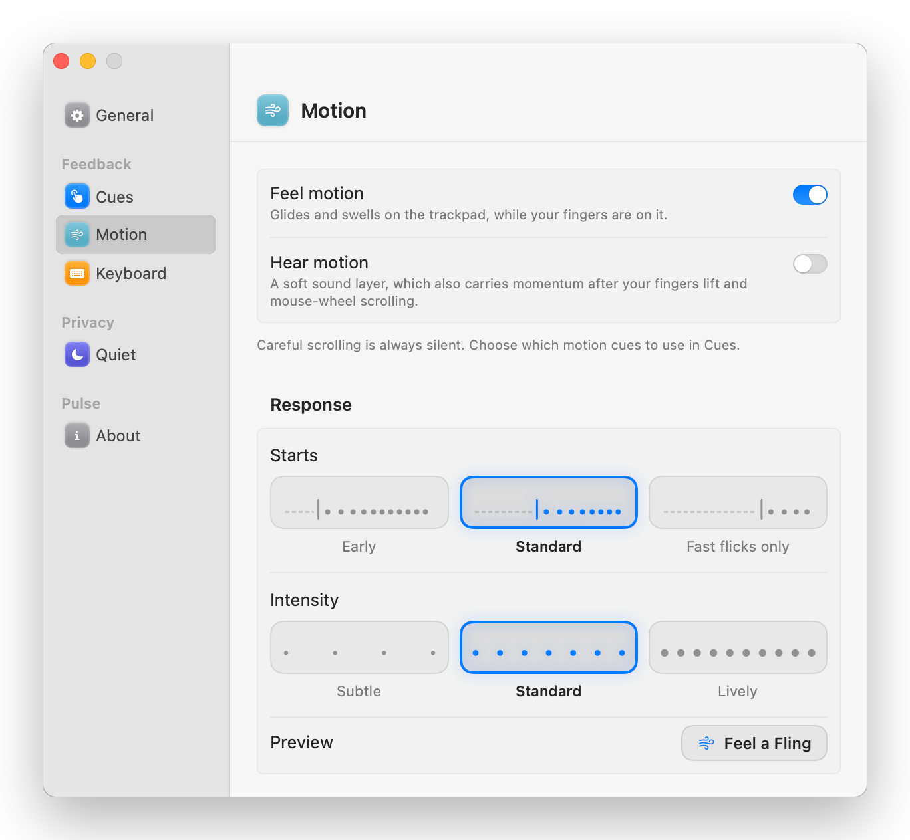

# Pulse in detail

Everything Pulse does, exactly. For the short version, see the
[README](../README.md).

## Setup

The first time Pulse opens, a short setup walks you through it: what Pulse
does, a practice page where every tap happens as you scroll down it, every tap
in a line to feel and switch on or off, the typing sound on a keyboard you can
try, the Accessibility permission, and open at login. Later, Settings ›
General › Open Tutorial… brings back the practice page, the taps and the
typing sound.

Pulse needs Accessibility access to tell a link from a button and to notice
key presses. Setup's permission step opens System Settings › Privacy &
Security › Accessibility and notices when you turn Pulse on. If you skip it,
choose Grant Access… from the menu-bar icon later.

## Taps on the page

Pulse learns a page's structure from what macOS Accessibility exposes. It
needs no browser extension and no page scripts.

| When | Tap |
| --- | --- |
| The pointer or keyboard focus reaches a link | **Link**: one light tick, once per link |
| The same for a button, checkbox, tab or menu | **Control**: one firmer tick |
| The same, but destructive (Delete, Remove…), a field with an error, or an alert | **Caution**: two strong pulses |
| The selected item in a sidebar, list or tab strip changes | **Navigation**: one crisp tick |
| A heading (h1–h3), or the start of a post or article, scrolls past the reading line | **Heading**: one soft pulse |
| Scrolling reaches the top or bottom | **Page end**: a landing and a small settle, never repeated while you hold there |
| Optional: a find-in-page match, or highlighted text, scrolls past the reading line | **Waypoint**: a rising pair |

The reading line is a third of the way down the window. Links that scroll
under a still pointer stay silent. Where an app exposes no structure, Pulse
says **Motion-only** in its menu; control, fast-scrolling and page-end taps
still work.
Find-in-page waypoints work in Safari and Chromium browsers, and highlighted
text in Safari; see [browser coverage](browser-coverage.md) for what each
browser exposes.

## Fast scrolling

Careful scrolling is silent. Past a speed (Early, Standard, or Fast flicks
only), a sparse **glide** begins: pulses come closer as you speed up and thin
out as you slow. A quick burst of speed is one soft **swell**, and reaching
the end of the page stops the glide. You feel these only while your fingers
are on the trackpad; momentum and mouse wheels can be heard (Hear motion) but
not felt. Intensity: Subtle, Standard or Lively.

## Feel, hear, or both

Page taps can also play a quiet tone (Tones for page cues). With haptics off,
every cue is a tone instead.

## Click once, on press

A Force Touch trackpad clicks twice: once as you press, and again as you let
go. While Pulse runs, it silences the second click, so each click is felt
once. It changes only the trackpad's release click, and puts it back when it
quits, is muted, or the setting is turned off. If Pulse is force-quit, it
puts it back the next time it runs.

## Typing sounds

| Sound | What you hear |
| --- | --- |
| **Ambient** (default) | One quiet, even tap on every key, which stays in the background |
| **Mechanical** | A real keyboard: each kind of key its own sound, with optional key-release sounds |
| **KeySense** | Short tones for kinds of keys (letters, Return, Delete, arrows, modifiers), plus shortcuts, Caps Lock and held-key repeats, which can also be felt |
| **Quiet** | Nothing |

Mechanical and Ambient sound like the **board** you choose:

| Board | Sound |
| --- | --- |
| **Black** | Cherry MX Black switches: heavy linears, brighter than Red, with a longer tail |
| **Red** (default) | Cherry MX Red switches: light linears, the darkest of the four, with a short tail |
| **Brown** | Cherry MX Brown switches: a tactile bump, the shortest of the four |
| **Blue** | Cherry MX Blue switches: a click on every press, by far the brightest |

Each board is rebuilt from measurements of Mechvibes' recordings of those
switches on ABS keycaps. No recordings ship with Pulse.

  <picture>
    <source media="(prefers-color-scheme: dark)" srcset="images/typing-dark.png">
    
  </picture>

## Staying quiet

Pulse goes quiet in password fields, while the microphone is in use, while
another app plays audio (music, video, a call; macOS 14.2 or later; taps
carry on), and in apps you turn it off for. While VoiceOver runs, typing
sounds stay off until you choose one yourself. **⌃⌥⌘M** mutes everything.

## The menu and Settings

The menu-bar icon shows whether the front app is Page-aware or Motion-only,
and offers Mute, Turn off in the front app, Settings…, and Quit.

With Line Apps (the bundle's short line in the menu bar), a click on the line
collapses Pulse's icon into it, with Tuck's, Hum's and Glow's, and another
brings them all back where they were. Pulse keeps working while its icon is
in the line. Pulse in the line's right-click menu, or opening Pulse again,
opens Settings. Quitting Line Apps brings the icon back.

Settings has six panes:
- **General**: mute, open at login, haptics and their strength, click once,
  a trackpad test, cue volume and tones, and the tutorial.
- **Cues**: every tap, to feel and switch on or off.
- **Motion**: fast-scrolling feel and sound.
- **Keyboard**: typing sound, board, and a keyboard to try them on.
- **Quiet**: when Pulse stays quiet, and the apps it's off in.
- **About**: the version, and links to the website, support, the privacy
  policy and the licence agreement.

  <picture>
    <source media="(prefers-color-scheme: dark)" srcset="images/settings-dark.png">
    
  </picture>

## Privacy

Pulse reads only the roles, states and positions that Accessibility exposes:
"a button", "a heading at this height". It checks control labels in memory to
spot destructive actions, and reads a browser's find bar ("Result 2 of 7")
only for its two numbers; neither is stored or logged. For typing, it uses
kinds of keys (letters, Return, Delete…) and modifier state, never the
characters. For other audio, it asks only whether an app is playing, never
what. Your settings are the only thing it saves.
